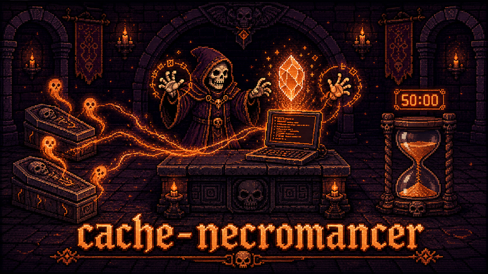
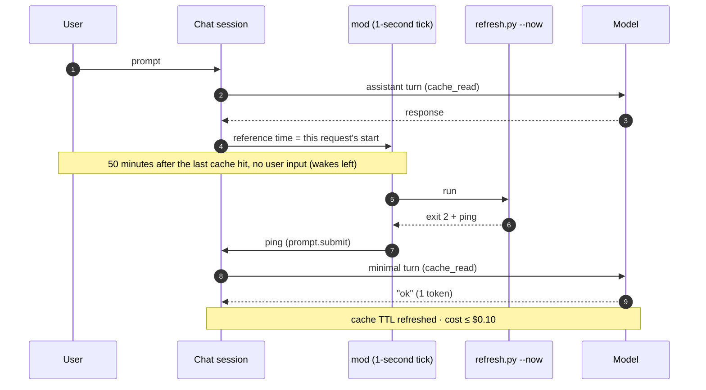

<div align="center">



> **A Claude Code plugin that keeps your 1-hour prompt cache alive while you are away, by waking the session a set number of times.**

  

[한국어](README.md) · **English**

</div>

---

## The Problem

Claude Code prompt cache TTL = **1 hour**.

| State | Input price (vs base input) |
|---|---|
| Cache valid (`cache_read`) | × 0.1 |
| Cache expired (`cache_create`, 1h ext) | × 2 |
| **🚨 First prompt after 1h (hit → miss)** | **≈ ×20 💸** |

> Meeting / lunch / step away for 50 min → come back → cost bomb.

Default behavior (v0.13.0): when you step away after your last input, it wakes the session **up to 2 times** to keep the cache alive (`auto_wakes`). Use `/cn:set N` to change that for this time away only, or `/cn:set off` to turn it off for this session. There are no macOS notifications — the band below the prompt and toasts show the time left.

## Install

```bash
/plugin marketplace add token-keeper/plugins
/plugin install cache-necromancer@token-keeper
```

Takes effect from **a new chat session**.

**Updating**: after `/plugin update`, `/reload-plugins` is enough (measured on 2026-11-13: reload alone, without a restart, switched the hooks to the new version too; restart Claude Code if anything looks off). Coming from v0.11.x, the old always/manual settings are ignored and every session wakes up to 2 times per time away — set `auto_wakes = 10` for the old always behavior, or `auto_wakes = 0` to turn automatic wakes off. `/cn:set 0` now turns wakes off for the session instead of cancelling a charge. See the 0.12.0 entry in the [CHANGELOG](CHANGELOG.md) (Korean).

## Slash Commands

| Command | Description |
|---|---|
| `/cn:set N` | Wake N times during this time away only (max 10, this session only). No arg = status |
| `/cn:set 2h` · `90m` · `1h30m` · `18:00` | Charge as many wakes as needed to keep the cache alive until that time (a past clock time means tomorrow) |
| `/cn:set auto` | Clear off/override and go back to automatic |
| `/cn:set 0` · `/cn:set off` | Turn wakes off for this session (until it ends; `/cn:set N` turns them back on) |
| `/cn:config` | Opens the settings panel (clicking `[ ⚙ ]` at the right of the band does the same; on the right when the screen is wide enough). Without mods it shows how to launch the terminal settings menu — see [Settings menu](#settings-menu-cnconfig) |
| `/cn:status` | Session state + wakes left and the latest time the cache stays alive (no API cost) |

`/cn:status` output:

```
┌─ 🔮 cache-necromancer ─────────────────────────────┐
│ ┌─ Session (current) ────────────────────────┐     │
│ │ sid:         3f2a9c1e                      │     │
│ │ wake:        auto · 2 left                 │     │
│ │ revived:     0× (this away)                │     │
│ │ next wake:   2026-11-13 14:21:27 (41m 50s) │     │
│ │ cache until: 16:11                         │     │
│ └────────────────────────────────────────────┘     │
│                                                    │
│ ┌─ Other sessions ──────────────────────────────┐  │
│ │ ┌─ b81c4d2e ────────────────────────────────┐ │  │
│ │ │ next wake: 13:54:27 (14m 50s)             │ │  │
│ │ │ prompt:    "refactor the settings screen" │ │  │
│ │ │ cwd:       ~/projects/web                 │ │  │
│ │ └───────────────────────────────────────────┘ │  │
│ └───────────────────────────────────────────────┘  │
│                                                    │
│ ┌─ Status ───────────────────────────────────────┐ │
│ │ auto wakes: 2 per away                         │ │
│ │ settings:   interval 50m · ttl 60m             │ │
│ │ plugin:     cache-necromancer v0.13.0 (active) │ │
│ └────────────────────────────────────────────────┘ │
└────────────────────────────────────────────────────┘
```

(actual output from an isolated run — the current session is automatic with 2 wakes, the other has a `/cn:set 3` override)

When a wake fires, the transcript shows:

```
[cn:keepalive 16:42, 1/2] reply with exactly 'ok @16:42 (1/2)'. ...
ok @16:42 (1/2)
```

`k/N` = wakes so far in this time away / `auto_wakes` (during a `/cn:set` override: used / charged).

## How It Works

### Wake rules

- After your last input, while you are away, it wakes the session every time `refresh_interval_minutes` (default 50) pass since the last cache hit — at most `auto_wakes` times (default 2) per time away. The wake turn reads the cache again, so the next cycle follows.
- Your next input resets the wake count to 0 — the next time away gets `auto_wakes` again.
- **`/cn:set N`**: overrides this time away with N wakes (max 10). There is no automatic share on top while the override lasts. A real prompt that arrives after at least one wake since charging counts as "returning" and ends the override. Prompts sent right after `/cn:set` (before any wake) keep it ("set, then one more thing").
- **`/cn:set 2h` · `90m` · `18:00`**: computes how many wakes keep the cache alive until that time and charges them. If the cache already lives that long nothing is charged (you just get a note); above 10 it charges 10 and shows the latest survival time. A time charge overrides this time away with just the wakes needed to reach that time — it can hold the cache for less than automatic wakes would, and if you keep working after charging, wakes may run past the target time.
- **`/cn:set auto`**: clears off/override and returns to automatic mode.
- **`/cn:set 0` · `/cn:set off`**: no wakes for this session until it ends. Your input doesn't undo it; only `/cn:set N` or `/cn:set auto` (panel `[Auto]`) turns wakes back on.
- Per session — other sessions need their own `/cn:set`.
- Messages from other sessions or teammates (`<cross-session-message`, `<teammate-message`), `<task-notification>`, wake pings and `/cn:*` commands don't count as your input.
- Right after `/clear` or `/compact` nothing wakes until your next input or the next Stop.

### Config file

`~/.cache-necromancer/config.toml` (auto-created on the first hook run):

| Key | Default | Values | Meaning |
|---|---|---|---|
| `[general] auto_wakes` | 2 | integer 0–10 | Max automatic wakes per time away. 0 = no automatic wakes (band and toasts only) |
| `[general] refresh_interval_minutes` | 50 | integer ≥1 | Wake this long after the last cache hit |
| `[general] cache_ttl_minutes` | 60 | integer ≥1 | Cache lifetime (band countdown and survival time) |
| `[general] language` | `"en"` | ko/en/ja/zh | Message language |
| `[display] countdown` | true | true/false | Band below the prompt |

```toml
[general]
auto_wakes = 2                        # max automatic wakes per time away (0 = none, max 10)
refresh_interval_minutes = 50         # wake this long after the last cache hit
cache_ttl_minutes = 60                # cache lifetime (band countdown and survival time)
language = "en"                       # ko | en | ja | zh

[display]
countdown = true                      # cache countdown in the band below the prompt (Claude Code v2.1.286+)
```

- An invalid value (wrong type or out of range) falls back to that key's default (the Python side warns on stderr; the band stays silent).
- Old settings (`[wake] arm`/`grace_seconds`, `[general] mode`/`max_refresh_count`, all of `[notify]`/`[refresh]`/`[advanced]`, `[display] recap_style`) are ignored since v0.12.0. `/cn:status` shows their count on one line, and saving from the settings menu removes them.
- **When changes apply**: immediately. Python reads the file on every run, and the mod checks it for changes every 5 seconds, so open sessions pick changes up without a new session or reload.

### Settings menu (`/cn:config`)

`/cn:config` (or `[ ⚙ ]` at the right of the band) opens the settings panel (on the right when the screen is wide enough; mods, Claude Code v2.1.286+). The top "This session" part shows one status line plus `[Off]`·`[Auto]`·`[1 hour]`·`[2 hours]`·`[4 hours]`; the bottom "Settings" part has buttons for auto wakes, wake timing, countdown band and language, saved and applied on click. Without mods `/cn:config` only prints the command to run; run it (`python3 ".../scripts/cn_config.py"`) in a new terminal to get a numbered menu.

- Items: `auto_wakes` (0 off / 1 / 2 default / 3) · `refresh_interval_minutes` (30 / 45 / 50 default) · `countdown` (show / hide) · `language`. Numeric items also accept a typed value instead of a number. Enter = keep.
- The current value shown is the value actually in effect (old keys and invalid values show as ignored). Text follows `language`.
- Saving removes ignored old key lines and old section headers left empty (comment lines stay).
- `cache_ttl_minutes` is not in the menu — setting it to `refresh_interval_minutes` or below leaves no window to wake in. Edit the file directly to change it.

## Countdown Band (v0.9.0)

Once all work is done and Claude is waiting for your input, the band right below the prompt (above the `? for shortcuts` hint line) shows the time left before the cache dies, ticking down every second.

```
  Cache 59:11 left       (language = "en", default)
  캐시 59:11 남음        (language = "ko")
```

Wake info for this time away is appended to the countdown with ` · ` (v0.12.0):

```
  Cache 52:10 left · 2 wakes left (until 14:40)              automatic (auto_wakes = 2, no wake yet)
  Cache 52:10 left · 5 wakes left (until 17:10)              /cn:set 5 override
  Cache 59:58 left · Revived 1× · 1 wake left (until 14:40)  right after a wake turn
  Cache 52:10 left · Wake off                                /cn:set off
  Cache 52:10 left                                           no wakes left
```

- `Revived N×` = wakes in this time away since your last input. Your next input resets it to 0.
- Wakes left = what remains of the charge during a `/cn:set` override, otherwise `auto_wakes` − wakes so far.
- The time in parentheses = reference time + wakes left × `refresh_interval_minutes` + `cache_ttl_minutes` — the latest the cache stays alive while you are away (local time, HH:MM). `/cn:set` and `/cn:status` use the same formula (the Python side uses the last Stop time instead of the reference time).
- Values come from this session's marker file (`~/.cache-necromancer/marker/<session_id>.json`), read every 5 seconds (right away after a wake). If the file is missing or broken, only the countdown shows.
- When the band is narrow, the revived count goes first, then wakes left. Nothing is appended after expiry.

- The reference time is the last main-conversation model request that actually read or wrote the cache (subagent requests and failed requests don't count). Wake turns are main-conversation requests too, so they should restart the count from 60:00 (not yet observed).
- The countdown color changes every 10 minutes of time left (v0.11.0): 60–50 min slate #b8c4d4 → 50–40 blue #8ec5ff → 40–30 green #8fe3a1 → 30–20 yellow #f2d16b → 20–10 orange #ffb454 → 10–0 and expired red #ff7b7b (a boundary belongs to the upper range — 50:00 is slate). The appended info stays slate.
- After `refresh_interval_minutes` (default 50 → 10 minutes left) a `Cache: 10 min left` toast fires; after `cache_ttl_minutes` it shows `Cache expired` with a toast. Each fires once per reference time.
- **Hidden while work is running** — while Claude is answering, or while a background agent (subagent etc.) is still `pending`/`running`/`waiting` after the main turn ended. The cache clock keeps running, so warning and expiry toasts still fire meanwhile. It stays while you are typing (v0.11.1).
  - A teammate in its own terminal window may stay `running` after its window is closed or dies, and the band can stay hidden meanwhile.
- Nothing is shown before the first request of a session (or after `/clear`).
- Right after `/compact` the band is cleared too, and counting restarts from the next answer's cache request (v0.9.1). An automatic compact in the middle of an answer leaves it as is.
- `[display] countdown = false` turns off both the band and the toasts (wakes keep working). Text follows `[general] language` (ko/en/ja/zh, default en). The band re-reads setting changes within 5 seconds (v0.13.0). When `/reload-plugins` loads the mod anew, the band and tick restart on the next request or screen redraw (v0.11.0).
- If the config file has a syntax error, both Python (wake, `/cn:status`) and the band drop the whole file and use defaults (settings are parsed by Python only).
- With the what-did-i-say plugin's band box, this line sits on top and the request box below it.

**Requires Claude Code v2.1.286 or later** (mods = function-hook plugins, loaded through the `modules` entry of `hooks/hooks.json`). Since v0.10.0 the mod also runs the wake, so on v2.1.200–v2.1.241, where the `modules` key is ignored without error, the band and wakes are both missing and only `/cn:*` remains (`modules` being ignored measured on v2.1.200 and later; older versions not checked). On v2.1.242–v2.1.285 mods sit behind a server rollout flag, so the band and wakes may work depending on the environment (flag-on environments not tested). Evidence: measured on 2026-10-07 with an isolated config on v2.1.200, v2.1.241 and v2.1.242–v2.1.286; `claude plugin test` passes on v2.1.287, v2.1.290, v2.1.291 and v2.1.292.

## Mechanics

The mod (`hooks/register.tsx`) counts with a 1-second tick from the start of the last main-conversation request that read or wrote the cache (the band's reference time).

Once `refresh_interval_minutes` have passed, it runs `scripts/refresh.py --now` once. If no new turn started after the last Stop (a running turn is skipped — including one started by a teammate or another session) and **wakes are left** for this time away, it emits a ping right away, which the mod submits as a prompt so the chat session **wakes itself** — short ping turn → model replies `ok` (1 token). With no wakes left (off, or all used) it does nothing — only the band and toasts show it.

When the wake turn reads the cache, the reference time moves and the next cycle follows (capped by `auto_wakes` or the `/cn:set` charge). A reference time already past `cache_ttl_minutes` (e.g. after sleep) does not wake. Up to v0.9.x a `Stop` hook + `asyncRewake` started a Python process that slept 50 minutes after every turn; since v0.10.0 there is no waiting process.

- A turn interrupted with Esc has no Stop, so nothing wakes until the next turn completes (same as v0.9.x).
- If `refresh_interval_minutes` is not below `cache_ttl_minutes`, there is no window to wake in, so wake is off; a toast says so at session start.
- If you charge with `/cn:set N` inside the wake window (reference time + `refresh_interval_minutes` up to `cache_ttl_minutes`), the mod checks again and wakes right then.

Because wake happens inside the chat process, the system prompt + tools stay byte-exact → **cache prefix 100% hit**.

Per-wake cost ≤ $0.10.



## Safety

- **Silent fail**: All hooks silent (exit 0). Never blocks chat.
- **Sensitive data**: the log (`cn.log.YYYY-MM-DD`) holds only session ids, check reasons and wake counts — no prompt or response bodies. The marker keeps the first 40 characters of your last prompt and the cwd for `/cn:status`.
- **Logs are never deleted automatically** — one file per day piles up; delete `~/.cache-necromancer/cn.log.*` yourself when needed. Markers are deleted at SessionEnd, and ones older than 7 days are cleaned up.
- **Permissions**: `~/.cache-necromancer` 0700, log/marker/config files 0600.
- **Atomic write**: markers use `tempfile + os.replace()`. Saving settings works the same way (tempfile in the same directory, then `os.replace`).

## Caveats

- Not an officially recommended pattern (Anthropic cache policy gray area). For personal use.
- Each wake incurs a minimal turn cost. By default it wakes up to 2 times per time away; if you don't want that, set `auto_wakes = 0` or run `/cn:set off` per session.
- Wake-up turn (`ok @HH:MM`) is permanently recorded in transcript.

## License

MIT — see `LICENSE`.
