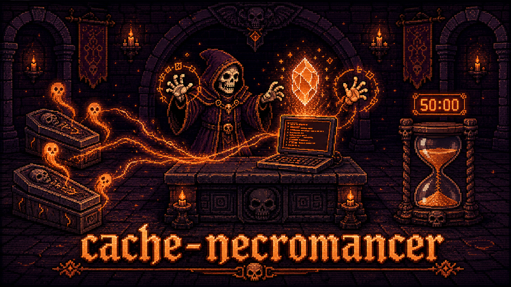
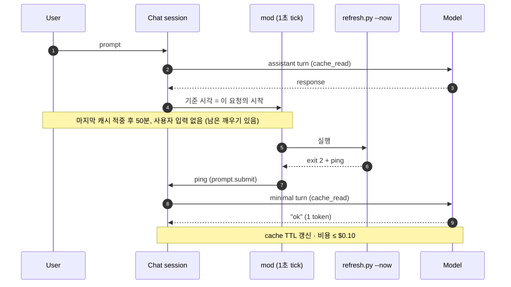

<div align="center">



> **Claude Code 1시간 프롬프트 캐시가 자리 비운 사이 죽지 않게, 정해 둔 횟수만큼 깨운다.**

  

**한국어** · [English](README.en.md)

</div>

---

## 무엇이 문제인가

Claude Code 프롬프트 캐시 TTL = **1 시간**.

| 상황 | input 단가 (base input 대비) |
|---|---|
| 캐시 유효 (`cache_read`) | × 0.1 |
| 캐시 만료 후 (`cache_create`, 1h ext) | × 2 |
| **🚨 1시간 후 첫 입력 (hit → miss)** | **≈ ×20 💸** |

> 회의 / 점심 / 자리 비움 50분 → 돌아와서 작업 재개 → 비용 폭탄.

기본 동작 (v0.13.0): 마지막 입력 뒤 자리를 비우면 **최대 2회** 자동으로 깨워 캐시를 살린다 (`auto_wakes`). 이번 자리비움만 다르게 하려면 `/cn:set N`, 이 세션은 아예 끄려면 `/cn:set off`. macOS 알림은 없다 — 남은 시간은 입력창 아래 띠와 토스트로 본다.

## 설치

```bash
/plugin marketplace add token-keeper/plugins
/plugin install cache-necromancer@token-keeper
```

설치 후 **새 chat 세션** 부터 적용된다.

**업데이트**: `/plugin update` 뒤 `/reload-plugins` 면 충분하다 (재시작 없이 reload 만으로 훅까지 새 버전으로 바뀌는 것을 2026-11-13 실측. 이상하면 Claude Code 를 재시작). v0.11.x 에서 올리면 옛 always·manual 설정은 무시되고 자리비움마다 최대 2회 자동 깨우기가 된다 — 예전 always 처럼 하려면 `auto_wakes = 10`, 자동 깨우기를 끄려면 `auto_wakes = 0`. `/cn:set 0` 은 이제 "충전 취소"가 아니라 이 세션 끄기다. 자세한 내용은 [CHANGELOG](CHANGELOG.md) 0.12.0.

## 슬래시 명령

| 명령 | 설명 |
|---|---|
| `/cn:set N` | 이번 자리비움만 N회 깨우기 (최대 10, 이 세션만). 무인자 = 상태 표시 |
| `/cn:set 2h`·`90m`·`1h30m`·`18:00` | 그 시간·시각까지 캐시를 살리는 데 필요한 횟수만큼 충전 (지난 시각은 다음 날) |
| `/cn:set auto` | 끔·덮어쓰기를 풀고 자동으로 되돌림 |
| `/cn:set 0` · `/cn:set off` | 이 세션 깨우기 끄기 (세션이 끝날 때까지, `/cn:set N` 으로 다시 켬) |
| `/cn:config` | 설정 패널 열기 (띠 오른쪽 `[ ⚙ ]` 클릭도 같음, 화면이 넓으면 오른쪽에 열림). mods 가 없으면 터미널 설정 메뉴 실행 방법 안내 — 아래 [설정 메뉴](#설정-메뉴-cnconfig) |
| `/cn:status` | 세션 상태 + 남은 깨우기·캐시 최대 생존 시각 (API 비용 0) |

`/cn:status` 출력 예시:

```
┌─ 🔮 cache-necromancer ──────────────────────────────┐
│ ┌─ 세션 (현재) ──────────────────────────────┐      │
│ │ sid:         3f2a9c1e                      │      │
│ │ 깨우기:      자동 · 2회 남음               │      │
│ │ 살림:        0번 (이번 자리비움)           │      │
│ │ 다음 깨우기: 2026-11-13 14:21:27 (41m 50s) │      │
│ │ 캐시 최대:   16:11                         │      │
│ └────────────────────────────────────────────┘      │
│                                                     │
│ ┌─ 다른 세션 ─────────────────────────────────────┐ │
│ │ ┌─ b81c4d2e ──────────────────────────────────┐ │ │
│ │ │ 다음 깨우기: 13:54:27 (14m 50s)             │ │ │
│ │ │ prompt:      "refactor the settings screen" │ │ │
│ │ │ 폴더:        ~/projects/web                 │ │ │
│ │ └─────────────────────────────────────────────┘ │ │
│ └─────────────────────────────────────────────────┘ │
│                                                     │
│ ┌─ 상태 ──────────────────────────────────────────┐ │
│ │ 자동 깨우기: 자리비움마다 2회                   │ │
│ │ 설정:        interval 50분 · ttl 60분           │ │
│ │ plugin:      cache-necromancer v0.13.0 (active) │ │
│ └─────────────────────────────────────────────────┘ │
└─────────────────────────────────────────────────────┘
```

(격리 환경에서 실제로 실행한 출력 — 현재 세션은 자동 2회, 다른 세션은 `/cn:set 3` 덮어쓰기 중)

깨우기가 일어나면 transcript:

```
[cn:keepalive 16:42, 1/2] reply with exactly 'ok @16:42 (1/2)'. ...
ok @16:42 (1/2)
```

`k/N` = 이번 자리비움에 깨운 횟수 / `auto_wakes` (`/cn:set` 덮어쓰기 중이면 쓴 횟수 / 충전량).

## 작동 방식

### 깨우기 규칙

- 마지막 사용자 입력 뒤 자리를 비우면, 캐시 마지막 적중 뒤 `refresh_interval_minutes`(기본 50분)가 지날 때마다 깨운다. 자리비움 한 번에 최대 `auto_wakes`회(기본 2). 깨우기 turn 이 캐시를 다시 읽어 다음 주기로 이어진다.
- 사용자가 입력하면 깨운 횟수는 0 으로 돌아간다 — 다음 자리비움은 다시 `auto_wakes`회.
- **`/cn:set N`**: 이번 자리비움만 N회로 덮어쓴다 (최대 10). 덮어쓰는 동안 자동 몫은 따로 없다. 충전 뒤 한 번이라도 깨운 다음 들어온 진짜 입력은 복귀로 보고 덮어쓰기를 푼다. 충전 직후(아직 깨우기 전) 추가 입력은 덮어쓰기를 유지한다 ("set 치고 하나만 더").
- **`/cn:set 2h`·`90m`·`18:00`**: 그 시각까지 캐시가 살아 있도록 필요한 깨우기 횟수를 계산해 충전한다. 이미 그 시각까지 살아 있으면 충전하지 않고 안내만, 10회를 넘으면 10회 + 최대 생존 시각을 안내한다. 시간 충전은 그 시각까지 지키는 데 필요한 횟수로 이번 자리비움을 덮어쓴다 — 자동 깨우기보다 짧게 지킬 수 있고, 충전 뒤 계속 작업하면 목표 시각을 넘겨 깨울 수 있다.
- **`/cn:set auto`**: 끔·덮어쓰기를 풀고 자동 모드로 되돌린다.
- **`/cn:set 0`·`/cn:set off`**: 이 세션은 끝날 때까지 깨우지 않는다. 사용자 입력으로도 풀리지 않고 `/cn:set N` 또는 `/cn:set auto`(패널 `[자동]`)로 다시 켠다.
- 세션마다 따로다 — 다른 세션은 각자 `/cn:set`.
- 다른 세션·팀메이트가 보낸 메시지(`<cross-session-message`·`<teammate-message`), `<task-notification>`, 깨우기 ping, `/cn:*` 명령은 사용자 입력으로 세지 않는다.
- `/clear`·`/compact` 직후에는 다음 사용자 입력이나 Stop 전까지 깨우지 않는다.

### 설정 파일

`~/.cache-necromancer/config.toml` (첫 hook 실행 시 자동 생성):

| 키 | 기본 | 값 | 의미 |
|---|---|---|---|
| `[general] auto_wakes` | 2 | 정수 0~10 | 자리비움마다 자동 깨우기 최대 횟수. 0 = 자동 깨우기 안 함 (띠·토스트만) |
| `[general] refresh_interval_minutes` | 50 | 정수 ≥1 | 캐시 마지막 적중 뒤 이만큼 지나면 깨우기 |
| `[general] cache_ttl_minutes` | 60 | 정수 ≥1 | 캐시 수명 (띠 카운트다운·생존 시각 기준) |
| `[general] language` | `"en"` | ko·en·ja·zh | 문구 언어 |
| `[display] countdown` | true | true·false | 입력창 아래 띠 |

```toml
[general]
auto_wakes = 2                        # 자리비움마다 자동 깨우기 최대 횟수 (0 = 깨우지 않음, 최대 10)
refresh_interval_minutes = 50         # 캐시 마지막 적중 뒤 이만큼 지나면 깨우기
cache_ttl_minutes = 60                # 캐시 수명 (띠 카운트다운·생존 시각 기준)
language = "en"                       # 메시지 언어: ko | en | ja | zh

[display]
countdown = true                      # 입력창 아래 띠에 캐시 남은 시간 카운트다운 (Claude Code v2.1.286+)
```

- 잘못된 값(타입·범위 밖)은 그 키만 기본값으로 쓴다 (Python 은 stderr 경고, 띠는 조용히).
- 옛 설정(`[wake] arm`·`grace_seconds`, `[general] mode`·`max_refresh_count`, `[notify]`·`[refresh]`·`[advanced]` 전체, `[display] recap_style`)은 v0.12.0 부터 무시된다. `/cn:status` 에 개수가 한 줄 뜨고, 설정 메뉴에서 저장하면 지워진다.
- **반영 시점**: 바로 반영된다. Python 은 실행마다 읽고, mod 는 5초마다 파일 변화를 보고 다시 읽으므로 새 세션·리로드 없이 열린 세션 모두에 적용된다.

### 설정 메뉴 (`/cn:config`)

`/cn:config`(또는 띠 오른쪽 `[ ⚙ ]`)는 설정 패널을 연다 (화면이 넓으면 오른쪽에 열린다. mods 있는 Claude Code v2.1.286+). 위 "이 세션"에는 상태 1줄과 `[끄기]`·`[자동]`·`[1시간]`·`[2시간]`·`[4시간]`, 아래 "전체 설정"에는 자동 깨우기·깨우기 시점·카운트다운 띠·언어 버튼이 있고 누르면 바로 저장·반영된다. mods 가 없으면 `/cn:config` 는 실행 명령만 알려 주고, 새 터미널에서 그 명령(`python3 ".../scripts/cn_config.py"`)을 실행하면 번호 메뉴가 뜬다.

- 항목: `auto_wakes`(0 끔·1·2 기본·3) · `refresh_interval_minutes`(30·45·50 기본) · `countdown`(표시·숨김) · `language`. 숫자 항목은 번호 대신 값을 직접 입력할 수도 있다. Enter = 유지.
- 현재값 표시는 실제 적용값이다 (옛 키·잘못된 값은 무시된 결과로 보인다). 문구는 `language` 를 따른다.
- 저장할 때 무시되는 옛 키 줄과 비게 된 옛 섹션 헤더를 지운다 (주석 줄은 남긴다).
- `cache_ttl_minutes` 는 메뉴에 없다 — `refresh_interval_minutes` 이하로 줄이면 깨울 구간이 없어진다. 바꾸려면 파일을 직접 편집한다.

## 카운트다운 띠 (v0.9.0)

모든 작업이 끝나 입력을 기다리는 동안, 입력창 바로 아래(`? for shortcuts` 힌트 줄 위) 띠에 캐시가 죽기까지 남은 시간을 1초씩 줄여 보여준다.

```
  캐시 59:11 남음        (language = "ko")
  Cache 59:11 left       (language = "en", 기본)
```

카운트다운 뒤에는 이번 자리비움의 깨우기 정보가 ` · ` 로 붙는다 (v0.12.0):

```
  캐시 52:10 남음 · 깨우기 2회 남음 (14:40까지)             자동 (auto_wakes = 2, 아직 안 깨움)
  캐시 52:10 남음 · 깨우기 5회 남음 (17:10까지)             /cn:set 5 덮어쓰기
  캐시 59:58 남음 · 1번 살림 · 깨우기 1회 남음 (14:40까지)   깨우기 turn 직후
  캐시 52:10 남음 · 깨우기 꺼짐                             /cn:set off
  캐시 52:10 남음                                          남은 깨우기 0
```

- `N번 살림` = 마지막 사용자 입력 뒤 이번 자리비움에 깨운 횟수. 사용자가 입력하면 0 으로 돌아간다.
- 남은 깨우기 = `/cn:set` 덮어쓰기 중이면 충전분 중 남은 것, 아니면 `auto_wakes` − 깨운 횟수.
- 괄호 안 시각 = 기준 시각 + 남은 횟수 × `refresh_interval_minutes` + `cache_ttl_minutes` — 자리를 비워도 캐시가 살아 있는 최대 시각 (로컬 시각 HH:MM). `/cn:set`·`/cn:status` 도 같은 식이다 (Python 은 기준 시각 대신 마지막 Stop 시각).
- 값은 이 세션의 marker 파일(`~/.cache-necromancer/marker/<session_id>.json`)에서 5초 간격(깨우기 직후엔 바로)으로 읽는다. 파일이 없거나 깨졌으면 카운트다운만 보인다.
- 띠 폭이 좁으면 살린 횟수 → 남은 깨우기 순으로 뺀다. 만료된 뒤에는 붙이지 않는다.

- 기준 시각은 메인 대화에서 캐시를 실제로 읽거나 쓴 마지막 모델 요청이다 (서브에이전트 요청·실패한 요청은 세지 않는다). 깨우기 turn 도 메인 대화의 요청이라 다시 60:00 부터 셀 것으로 예상한다 (실측 전).
- 카운트다운 글자색은 남은 시간 10분 구간마다 바뀐다 (v0.11.0): 60~50분 회청 #b8c4d4 → 50~40 파랑 #8ec5ff → 40~30 초록 #8fe3a1 → 30~20 노랑 #f2d16b → 20~10 주황 #ffb454 → 10~0·만료 빨강 #ff7b7b (경계는 위 구간 — 50:00 은 회청). 뒤 정보는 회청 그대로.
- `refresh_interval_minutes` 가 지나면(기본 50분 → 남은 10분) `캐시 10분 남음` 토스트, `cache_ttl_minutes` 가 지나면 `캐시 만료` + 토스트. 같은 기준 시각에서는 한 번씩만 알린다.
- **작업 중에는 숨는다** — 답변 중이거나, 리더 턴이 끝났어도 백그라운드 에이전트(서브에이전트 등)가 실행 중(`pending`·`running`·`waiting`)이면 띠를 그리지 않는다. 캐시 시계는 흐르므로 그동안에도 경고·만료 토스트는 울린다. 글자를 치는 중에는 숨지 않는다 (v0.11.1).
  - 별도 터미널 창의 팀메이트는 창이 닫히거나 죽어도 상태가 `running` 으로 남을 수 있고, 그동안 띠가 계속 숨을 수 있다.
- 세션이 시작된 뒤(또는 `/clear` 뒤) 첫 요청 전에는 아무것도 표시하지 않는다.
- `/compact` 직후에도 띠를 비우고, 다음 답변에서 캐시를 쓴 요청부터 다시 센다 (v0.9.1). 답변 도중 자동 compact 는 그대로 둔다.
- `[display] countdown = false` 면 띠와 토스트를 모두 끈다 (깨우기는 그대로 동작). 문구는 `[general] language`(ko·en·ja·zh, 기본 en)를 따른다. 띠는 설정 변경을 5초 안에 다시 읽어 반영한다 (v0.13.0). `/reload-plugins` 로 mod 가 새로 로드되면 띠·tick 이 첫 요청이나 화면 갱신 때 다시 시작한다 (v0.11.0).
- 설정 파일에 문법 오류가 있으면 Python(깨우기 판정·`/cn:status`)과 띠 모두 파일 전체를 버리고 기본값을 쓴다 (설정 해석은 Python 하나).
- what-did-i-say 플러그인의 띠 박스와 함께 쓰면 이 줄이 위, 요청 박스가 아래로 붙는다.

**요구: Claude Code v2.1.286 이상** (mods = 함수 훅 플러그인, `hooks/hooks.json` 의 `modules` 항목으로 로드). v0.10.0 부터는 깨우기도 mod 가 실행하므로, v2.1.200~v2.1.241 에서는 `modules` 키가 오류 없이 무시되어 띠·깨우기가 빠지고 `/cn:*` 만 남는다 (`modules` 무시는 v2.1.200 이상에서 실측, 그 미만은 미확인). v2.1.242~v2.1.285 는 mods 가 서버 롤아웃 플래그 뒤에 있어 환경에 따라 띠·깨우기가 동작할 수도 있다 (플래그가 켜진 환경은 추정). 근거: 2026-10-07 격리 설정으로 v2.1.200·v2.1.241·v2.1.242~v2.1.286 실측, v2.1.287·v2.1.290·v2.1.291·v2.1.292 에서 `claude plugin test` 통과.

## 어떻게 동작하는가

구성요소·상태 저장소·알려진 제약은 [docs/ARCHITECTURE.md](docs/ARCHITECTURE.md) 에 정리했다.

mod(`hooks/register.tsx`)가 메인 대화에서 캐시를 마지막으로 읽거나 쓴 요청의 시작 시각부터 1초 tick 으로 센다 (띠와 같은 기준 시각).

`refresh_interval_minutes` 가 지나면 `scripts/refresh.py --now` 를 1회 실행한다. 마지막 Stop 뒤 새 turn 이 없고(진행 중인 turn 이면 건너뜀 — 팀메이트·다른 세션 메시지로 시작한 turn 포함) 이번 자리비움에 **남은 깨우기가 있으면** 바로 ping 을 내고, mod 가 그 ping 을 프롬프트로 제출해 chat 세션이 **자기 자신을 깨운다** — 짧은 ping turn → 모델 `ok` 1 token. 남은 깨우기가 없으면(꺼짐·횟수 다 씀) 아무것도 하지 않는다 — 띠·토스트로만 보인다.

깨우기 turn 이 캐시를 읽으면 기준 시각이 갱신되어 다음 주기로 이어진다 (상한은 `auto_wakes` 또는 `/cn:set` 충전량). 이미 `cache_ttl_minutes` 가 지난 기준 시각(잠자기 복귀 등)으로는 깨우지 않는다. v0.9.x 까지는 매 turn 끝 `Stop` hook + `asyncRewake` 가 50분 sleep 하는 Python 프로세스를 띄웠지만, v0.10.0 부터 대기 프로세스는 없다.

- Esc 로 중단한 turn 은 Stop 이 없어, 다음 turn 이 끝날 때까지 깨우지 않는다 (v0.9.x 와 같다).
- `refresh_interval_minutes` 가 `cache_ttl_minutes` 이상이면 깨울 구간이 없어 깨우기가 꺼진다. 세션 시작 때 토스트로 알린다.
- 깨우기 구간(기준 시각 + `refresh_interval_minutes` ~ `cache_ttl_minutes`) 안에서 `/cn:set N` 으로 충전하면 mod 가 다시 판정해 그 자리에서 깨운다.

chat 프로세스 내부에서 깨우므로 system prompt + tools 가 byte-exact 보존됨 → **cache prefix 100% hit**.

깨우기 1회 비용 ≤ $0.10.



## 안전성

- **Silent fail**: 모든 hook silent (exit 0). chat 동작 차단 X.
- **민감정보**: 로그(`cn.log.YYYY-MM-DD`)에는 세션 id·판정 사유·깨우기 횟수만 남고 프롬프트·응답 본문은 기록하지 않는다. marker 에는 `/cn:status` 표시용으로 마지막 프롬프트 앞 40자와 cwd 가 저장된다.
- **로그는 자동 삭제하지 않는다** — 날짜별 파일이 쌓이므로 필요하면 `~/.cache-necromancer/cn.log.*` 를 직접 지운다. marker 는 SessionEnd 때 지우고 7일 넘은 것도 정리한다.
- **권한**: `~/.cache-necromancer` 0700, 로그·marker·config 파일 0600.
- **Atomic write**: marker 는 `tempfile + os.replace()`. 설정 저장도 같은 방식(같은 디렉터리 tempfile → `os.replace`)이다.

## 비추천 / 주의

- 공식 권장 패턴 아님 (Anthropic 캐시 정책 회색지대). 개인 사용 목적.
- 깨우기마다 minimal turn 비용이 든다. 기본으로 자리비움마다 최대 2회 자동으로 깨우므로, 원치 않으면 `auto_wakes = 0` 또는 세션마다 `/cn:set off`.
- 깨우기 turn (`ok @HH:MM`) 은 영구 transcript 기록.

## 라이선스

MIT — `LICENSE` 참조.
